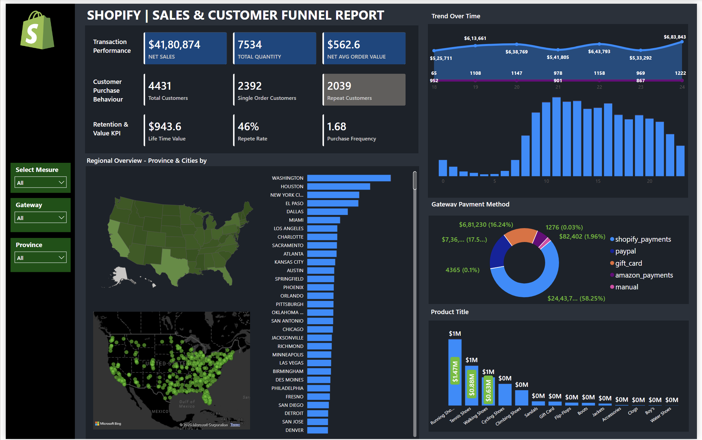

# Shopify Sales & Customer Analytics

An interactive Power BI dashboard designed to analyse e-commerce sales performance, customer purchasing behaviour and business trends.

## Dashboard Preview

## Tools & Technologies
- Microsoft Power BI
- DAX

## Key Analysis
- Sales and revenue performance
- Customer retention and repeat purchases
- Customer lifetime value
- Product and category performance
- Geographic sales distribution
- Payment method analysis

## Project Files
- `Dashboard/` – Power BI dashboard (.pbix)
- `Screenshots/` – Dashboard preview
- `Documentation/` – Supporting project documentation

**Note:** Customer information is synthetic/dummy data.
